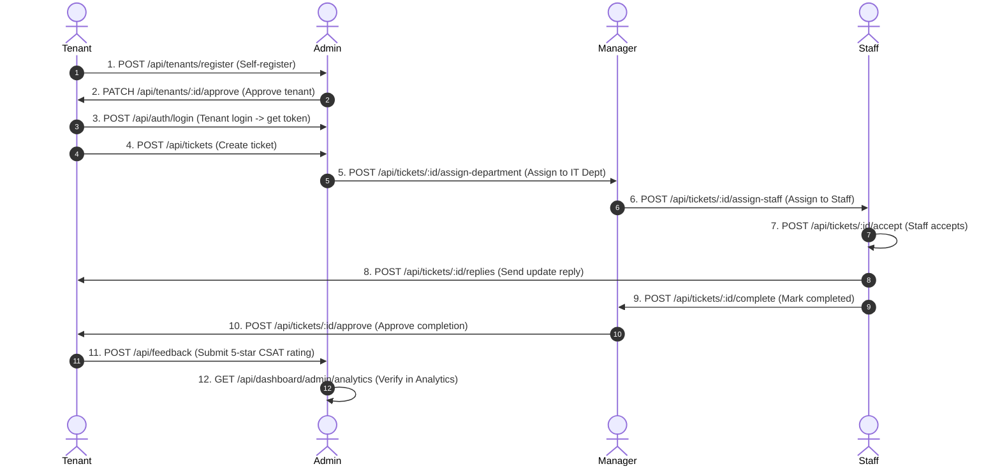

# 🚀 Help Desk Management System (HDMS) — Postman API Testing Guide

Comprehensive testing documentation for testing all backend REST API endpoints in **Postman**.

---

## 📋 Table of Contents
1. [Environment & Configuration Setup](#1-environment--configuration-setup)
2. [Default Test Accounts Matrix](#2-default-test-accounts-matrix)
3. [Postman Automatic JWT Token Setup (Pre-request / Tests Script)](#3-postman-automatic-jwt-token-setup)
4. [Module-by-Module Endpoint Catalog](#4-module-by-module-endpoint-catalog)
   - [1. Authentication & Profile (`/api/auth`)](#1-authentication--profile-apiauth)
   - [2. Tickets & Lifecycle (`/api/tickets`)](#2-tickets--lifecycle-apitickets)
   - [3. Dashboards & Analytics (`/api/dashboard`)](#3-dashboards--analytics-apidashboard)
   - [4. Users & Roles Management (`/api/users`)](#4-users--roles-management-apiusers)
   - [5. Departments & Hierarchy (`/api/departments`)](#5-departments--hierarchy-apidepartments)
   - [6. Matrix & Assignment Grid (`/api/matrix`)](#6-matrix--assignment-grid-apimatrix)
   - [7. SLA Policies & Calculator (`/api/sla`)](#7-sla-policies--calculator-apisla)
   - [8. Tenants Management (`/api/tenants`)](#8-tenants-management-apitenants)
   - [9. Ticket Categories & Routing (`/api/ticket-categories`)](#9-ticket-categories--routing-apiticket-categories)
   - [10. Notices & Broadcasts (`/api/notices`)](#10-notices--broadcasts-apinotices)
   - [11. Knowledge Base Articles (`/api/knowledge`)](#11-knowledge-base-articles-apiknowledge)
   - [12. Tenant Feedback & CSAT (`/api/feedback`)](#12-tenant-feedback--csat-apifeedback)
   - [13. Real-Time Chat & Rooms (`/api/chat`)](#13-real-time-chat--rooms-apichat)
   - [14. Audit Logs & Compliance (`/api/audit`)](#14-audit-logs--compliance-apiaudit)
   - [15. Reports & CSV Export (`/api/reports`)](#15-reports--csv-export-apireports)
   - [16. System Health Check (`/api/health`)](#16-system-health-check-apihealth)
5. [End-to-End (E2E) Workflow Testing Sequence](#5-end-to-end-e2e-workflow-testing-sequence)

---

## 1. Environment & Configuration Setup

### Postman Environment Variables:
Create an environment named `HDMS Local` in Postman with the following variables:

| Variable Name | Initial Value | Current Value | Description |
|---|---|---|---|
| `baseUrl` | `http://localhost:5000/api` | `http://localhost:5000/api` | Backend API root URL |
| `token` | *(leave empty)* | *(dynamically set on login)* | Bearer JWT token |
| `ticketId` | *(leave empty)* | *(populated during tests)* | Active ticket UUID |
| `departmentId` | *(leave empty)* | *(populated during tests)* | Active department UUID |
| `userId` | *(leave empty)* | *(populated during tests)* | Active user UUID |
| `tenantId` | *(leave empty)* | *(populated during tests)* | Active tenant UUID |
| `categoryId` | *(leave empty)* | *(populated during tests)* | Active category UUID |
| `slaPolicyId` | *(leave empty)* | *(populated during tests)* | Active SLA policy UUID |
| `noticeId` | *(leave empty)* | *(populated during tests)* | Active notice UUID |
| `articleId` | *(leave empty)* | *(populated during tests)* | Active KB article UUID |
| `roomId` | *(leave empty)* | *(populated during tests)* | Active chat room UUID |

---

## 2. Default Test Accounts Matrix

| Role | Identifier / Email | Password | Access Rights |
|---|---|---|---|
| **Admin** | `admin` *(or `admin@helpdesk.com`)* | `Admin@123` | Full system control, user management, SLA policies, approvals, analytics |
| **Manager** | `manager` *(or `manager@helpdesk.com`)* | `Manager@123` | Department tickets, staff assignments, notice publishing, knowledge review |
| **Staff** | `staff` *(or `staff@helpdesk.com`)* | `Staff@123` | Assigned ticket handling, replies, status updates, internal notes |
| **Tenant** | `tenant` *(or `tenant@example.com`)* | `Tenant@123` | Ticket creation, tracking, feedback submission, KB browsing |
| **CEO** | `ceo` *(or `ceo@helpdesk.com`)* | `Ceo@123` | Executive analytics, department performance, executive approvals |

---

## 3. Postman Automatic JWT Token Setup

To automatically capture and use the JWT token across all requests:

1. In Postman, open the **`POST /api/auth/login`** request.
2. Go to the **Tests** tab and paste the following snippet:

```javascript
// Automatically extract token and user details upon successful login
if (pm.response.code === 200) {
    const json = pm.response.json();
    if (json.data && json.data.token) {
        pm.environment.set("token", json.data.token);
        pm.environment.set("userId", json.data.user.id);
        pm.environment.set("userRole", json.data.user.role);
        console.log("✅ Token successfully stored:", json.data.token.slice(0, 15) + "...");
    }
}

// Basic assertions
pm.test("Status code is 200 OK", function () {
    pm.response.to.have.status(200);
});

pm.test("Response contains valid JWT token", function () {
    const json = pm.response.json();
    pm.expect(json.success).to.eql(true);
    pm.expect(json.data.token).to.be.a("string");
});
```

3. In the Postman Collection's **Authorization** tab, select:
   - **Type:** `Bearer Token`
   - **Token:** `{{token}}`

Every endpoint inheriting authorization will automatically attach the valid Bearer token!

---

## 4. Module-by-Module Endpoint Catalog

---

### 1. Authentication & Profile (`/api/auth`)

#### `POST /api/auth/login`
- **Description:** Authenticate with username or email and retrieve JWT token + user profile.
- **Headers:** `Content-Type: application/json`
- **Body (raw JSON):**
  ```json
  {
    "identifier": "admin",
    "password": "Admin@123"
  }
  ```
- **Expected Status:** `200 OK`
- **Response Structure:**
  ```json
  {
    "success": true,
    "message": "Login successful",
    "data": {
      "token": "eyJhbGciOi...",
      "user": {
        "id": "uuid",
        "username": "admin",
        "email": "admin@helpdesk.com",
        "role": "admin",
        "permissions": ["*"]
      }
    }
  }
  ```

#### `GET /api/auth/me`
- **Description:** Retrieve the currently authenticated user profile and permissions.
- **Headers:** `Authorization: Bearer {{token}}`
- **Expected Status:** `200 OK`

#### `POST /api/auth/refresh`
- **Description:** Exchange refresh token cookie for a fresh access token.
- **Expected Status:** `200 OK`

#### `PATCH /api/auth/me/profile`
- **Description:** Update current user's profile details.
- **Headers:** `Authorization: Bearer {{token}}`, `Content-Type: application/json`
- **Body:**
  ```json
  {
    "firstName": "Super",
    "lastName": "Administrator",
    "phone": "+1234567890"
  }
  ```
- **Expected Status:** `200 OK`

#### `PATCH /api/auth/me/theme`
- **Description:** Save user theme preference (`system`, `light`, `dark`).
- **Headers:** `Authorization: Bearer {{token}}`, `Content-Type: application/json`
- **Body:**
  ```json
  {
    "themePreference": "dark"
  }
  ```
- **Expected Status:** `200 OK`

#### `POST /api/auth/logout`
- **Description:** Invalidate current user session and clear cookies.
- **Headers:** `Authorization: Bearer {{token}}`
- **Expected Status:** `200 OK`

---

### 2. Tickets & Lifecycle (`/api/tickets`)

#### `GET /api/tickets/track/:trackNumber`
- **Description:** Public endpoint to track ticket status using reference track number without authentication.
- **Example URL:** `{{baseUrl}}/tickets/track/TICK-2026-0001`
- **Expected Status:** `200 OK`

#### `GET /api/tickets`
- **Description:** List tickets with pagination, status, priority, and department filters.
- **Headers:** `Authorization: Bearer {{token}}`
- **Query Params:**
  - `page`: `1`
  - `limit`: `20`
  - `status`: `open` *(optional)*
  - `priority`: `high` *(optional)*
  - `sortBy`: `created_at` *(optional)*
  - `sortOrder`: `DESC` *(optional)*
- **Expected Status:** `200 OK`

#### `POST /api/tickets`
- **Description:** Create a new ticket (Tenant, Admin, or Staff).
- **Headers:** `Authorization: Bearer {{token}}`, `Content-Type: application/json` *(or `multipart/form-data` if attaching files)*
- **Body (raw JSON):**
  ```json
  {
    "title": "Network connectivity issue on Floor 3",
    "description": "Switch port 12 seems unresponsive since morning reboot.",
    "category": "Network Infrastructure",
    "priority": "high",
    "departmentId": "{{departmentId}}"
  }
  ```
- **Expected Status:** `201 Created`
- **Test Script:**
  ```javascript
  if (pm.response.code === 201) {
      const json = pm.response.json();
      pm.environment.set("ticketId", json.data.id);
  }
  ```

#### `GET /api/tickets/:id`
- **Description:** Get complete ticket record by UUID.
- **Example URL:** `{{baseUrl}}/tickets/{{ticketId}}`
- **Headers:** `Authorization: Bearer {{token}}`
- **Expected Status:** `200 OK`

#### `GET /api/tickets/:id/timeline`
- **Description:** Get audit trail timeline of all state transitions and events for a ticket.
- **Example URL:** `{{baseUrl}}/tickets/{{ticketId}}/timeline`
- **Expected Status:** `200 OK`

#### `POST /api/tickets/:id/assign-department`
- **Description:** Admin assigns ticket to a specific department.
- **Headers:** `Authorization: Bearer {{token}}`, `Content-Type: application/json`
- **Body:**
  ```json
  {
    "departmentId": "{{departmentId}}",
    "notes": "Assigned to IT Infrastructure Department"
  }
  ```
- **Expected Status:** `200 OK`

#### `POST /api/tickets/:id/assign-staff`
- **Description:** Admin or Department Manager assigns ticket to a staff member.
- **Headers:** `Authorization: Bearer {{token}}`, `Content-Type: application/json`
- **Body:**
  ```json
  {
    "staffId": "{{userId}}",
    "notes": "Assigned to primary network technician"
  }
  ```
- **Expected Status:** `200 OK`

#### `POST /api/tickets/:id/accept`
- **Description:** Staff member accepts assigned ticket.
- **Headers:** `Authorization: Bearer {{token}}`
- **Expected Status:** `200 OK`

#### `POST /api/tickets/:id/replies`
- **Description:** Post public or internal reply message on ticket.
- **Headers:** `Authorization: Bearer {{token}}`, `Content-Type: application/json`
- **Body:**
  ```json
  {
    "message": "We have dispatched a technician to inspect the switch port.",
    "visibility": "all"
  }
  ```
- **Expected Status:** `201 Created`

#### `POST /api/tickets/:id/internal-note`
- **Description:** Post staff/manager internal private note.
- **Headers:** `Authorization: Bearer {{token}}`, `Content-Type: application/json`
- **Body:**
  ```json
  {
    "message": "Port 12 VLAN tag was misconfigured during maintenance."
  }
  ```
- **Expected Status:** `200 OK`

#### `PATCH /api/tickets/:id/status`
- **Description:** Change ticket lifecycle status (`in_progress`, `pending`, `resolved`, `closed`, `escalated`).
- **Headers:** `Authorization: Bearer {{token}}`, `Content-Type: application/json`
- **Body:**
  ```json
  {
    "status": "in_progress",
    "notes": "Diagnostics in progress"
  }
  ```
- **Expected Status:** `200 OK`

#### `POST /api/tickets/:id/complete`
- **Description:** Staff/Manager marks ticket as completed and submits for review.
- **Headers:** `Authorization: Bearer {{token}}`, `Content-Type: application/json`
- **Body:**
  ```json
  {
    "notes": "Switch port reconfigured and tested with 1Gbps link."
  }
  ```
- **Expected Status:** `200 OK`

#### `POST /api/tickets/:id/approve`
- **Description:** Admin approves resolution or Tenant approves satisfaction.
- **Headers:** `Authorization: Bearer {{token}}`, `Content-Type: application/json`
- **Body:**
  ```json
  {
    "notes": "Verified and approved"
  }
  ```
- **Expected Status:** `200 OK`

#### `POST /api/tickets/:id/close`
- **Description:** Close ticket.
- **Headers:** `Authorization: Bearer {{token}}`, `Content-Type: application/json`
- **Expected Status:** `200 OK`

#### `POST /api/tickets/:id/reopen`
- **Description:** Reopen closed ticket if issue persists.
- **Headers:** `Authorization: Bearer {{token}}`, `Content-Type: application/json`
- **Body:**
  ```json
  {
    "notes": "Link dropped again after 1 hour."
  }
  ```
- **Expected Status:** `200 OK`

#### `POST /api/tickets/:id/escalate`
- **Description:** Escalate ticket to upper management.
- **Headers:** `Authorization: Bearer {{token}}`, `Content-Type: application/json`
- **Body:**
  ```json
  {
    "notes": "Hardware replacement required, escalating to Head of IT."
  }
  ```
- **Expected Status:** `200 OK`

---

### 3. Dashboards & Analytics (`/api/dashboard`)

#### `GET /api/dashboard/admin`
- **Description:** Summary metrics, urgent tickets, SLA overviews for Admin.
- **Headers:** `Authorization: Bearer {{token}}`
- **Expected Status:** `200 OK`

#### `GET /api/dashboard/admin/analytics`
- **Description:** Complete analytical data (Monthly/Weekly/Daily trends, Status breakdown, Priority distribution, Department matrix, Category breakdown).
- **Headers:** `Authorization: Bearer {{token}}`
- **Query Params:**
  - `timeframe`: `6m` *(options: `7d`, `30d`, `90d`, `6m`, `12m`, `all`)*
  - `departmentId`: `{{departmentId}}` *(optional)*
- **Expected Status:** `200 OK`

#### `GET /api/dashboard/manager`
- **Description:** Department-specific dashboard for Manager role.
- **Headers:** `Authorization: Bearer {{token}}`
- **Expected Status:** `200 OK`

#### `GET /api/dashboard/staff`
- **Description:** Assigned workload and pending task queue for Staff role.
- **Headers:** `Authorization: Bearer {{token}}`
- **Expected Status:** `200 OK`

#### `GET /api/dashboard/tenant`
- **Description:** Tenant ticket activity, open requests, and notices.
- **Headers:** `Authorization: Bearer {{token}}`
- **Expected Status:** `200 OK`

#### `GET /api/dashboard/ceo`
- **Description:** High-level executive statistics and organizational KPIs for CEO.
- **Headers:** `Authorization: Bearer {{token}}`
- **Expected Status:** `200 OK`

#### `GET /api/dashboard/ceo/departments`
- **Description:** Department performance and turnaround analysis for CEO.
- **Headers:** `Authorization: Bearer {{token}}`
- **Expected Status:** `200 OK`

---

### 4. Users & Roles Management (`/api/users`)

#### `GET /api/users/roles`
- **Description:** List all available system roles (`admin`, `manager`, `staff`, `tenant`, `ceo`).
- **Headers:** `Authorization: Bearer {{token}}`
- **Expected Status:** `200 OK`

#### `GET /api/users`
- **Description:** Paginated user list with role and department filters.
- **Headers:** `Authorization: Bearer {{token}}`
- **Query Params:** `page=1&limit=20&role=staff&status=active`
- **Expected Status:** `200 OK`

#### `POST /api/users`
- **Description:** Create a new user account.
- **Headers:** `Authorization: Bearer {{token}}`, `Content-Type: application/json`
- **Body:**
  ```json
  {
    "username": "alex_tech",
    "email": "alex@helpdesk.com",
    "password": "Password@123",
    "firstName": "Alex",
    "lastName": "Smith",
    "roleId": 3,
    "status": "active"
  }
  ```
- **Expected Status:** `201 Created`

#### `GET /api/users/:id`
- **Description:** Retrieve user details by ID.
- **Expected Status:** `200 OK`

#### `PUT /api/users/:id`
- **Description:** Update user details.
- **Expected Status:** `200 OK`

#### `PATCH /api/users/:id/activate` & `PATCH /api/users/:id/deactivate`
- **Description:** Toggle user active/inactive state.
- **Expected Status:** `200 OK`

#### `PATCH /api/users/:id/reset-password`
- **Description:** Admin reset user's password.
- **Body:**
  ```json
  {
    "newPassword": "NewSecurePassword@123"
  }
  ```
- **Expected Status:** `200 OK`

---

### 5. Departments & Hierarchy (`/api/departments`)

#### `GET /api/departments/active`
- **Description:** List all active departments for dropdown selections.
- **Headers:** `Authorization: Bearer {{token}}`
- **Expected Status:** `200 OK`

#### `GET /api/departments`
- **Description:** Paginated departments list.
- **Expected Status:** `200 OK`

#### `POST /api/departments`
- **Description:** Create a new department.
- **Headers:** `Authorization: Bearer {{token}}`, `Content-Type: application/json`
- **Body:**
  ```json
  {
    "name": "Information Technology",
    "code": "IT_DEPT",
    "description": "Hardware, Network, and Software Operations",
    "status": "active"
  }
  ```
- **Expected Status:** `201 Created`

#### `GET /api/departments/:id/members`
- **Description:** List members belonging to a department.
- **Expected Status:** `200 OK`

#### `POST /api/departments/:id/members`
- **Description:** Assign users to department.
- **Body:**
  ```json
  {
    "userIds": ["{{userId}}"]
  }
  ```
- **Expected Status:** `200 OK`

---

### 6. Matrix & Assignment Grid (`/api/matrix`)

#### `GET /api/matrix/grid`
- **Description:** Complete user-to-department matrix grid.
- **Headers:** `Authorization: Bearer {{token}}`
- **Expected Status:** `200 OK`

#### `PATCH /api/matrix/toggle`
- **Description:** Toggle user assignment to a department in the matrix grid.
- **Body:**
  ```json
  {
    "userId": "{{userId}}",
    "departmentId": "{{departmentId}}",
    "assigned": true
  }
  ```
- **Expected Status:** `200 OK`

---

### 7. SLA Policies & Calculator (`/api/sla`)

#### `GET /api/sla`
- **Description:** List all SLA policies.
- **Headers:** `Authorization: Bearer {{token}}`
- **Expected Status:** `200 OK`

#### `GET /api/sla/preview`
- **Description:** Preview SLA response and resolution targets for a given priority and category.
- **Query Params:** `priority=urgent&categoryId={{categoryId}}`
- **Expected Status:** `200 OK`

#### `POST /api/sla`
- **Description:** Create SLA policy.
- **Headers:** `Authorization: Bearer {{token}}`, `Content-Type: application/json`
- **Body:**
  ```json
  {
    "name": "Critical Infrastructure SLA",
    "priority": "urgent",
    "responseHours": 1,
    "resolutionHours": 4,
    "escalationHours": 2,
    "description": "24/7 immediate priority response"
  }
  ```
- **Expected Status:** `201 Created`

---

### 8. Tenants Management (`/api/tenants`)

#### `POST /api/tenants/register` *(Public)*
- **Description:** Self-registration endpoint for new tenants.
- **Body:**
  ```json
  {
    "organizationName": "Acme Corp",
    "contactPerson": "Jane Doe",
    "email": "jane@acme.com",
    "username": "janedoe_acme",
    "password": "Password@123",
    "confirmPassword": "Password@123",
    "phone": "+1987654321",
    "registrationNumber": "REG-2026-99"
  }
  ```
- **Expected Status:** `201 Created`

#### `GET /api/tenants`
- **Description:** Admin view of all registered tenants.
- **Expected Status:** `200 OK`

#### `PATCH /api/tenants/:id/approve`
- **Description:** Admin approves pending tenant registration.
- **Expected Status:** `200 OK`

#### `GET /api/tenants/profile/me`
- **Description:** Tenant view of own organization profile.
- **Expected Status:** `200 OK`

---

### 9. Ticket Categories & Routing (`/api/ticket-categories`)

#### `GET /api/ticket-categories`
- **Description:** List all active ticket categories.
- **Headers:** `Authorization: Bearer {{token}}`
- **Expected Status:** `200 OK`

#### `POST /api/ticket-categories`
- **Description:** Create new ticket category with direct routing or general routing.
- **Body:**
  ```json
  {
    "name": "Cloud Services",
    "description": "AWS, Azure, and Google Cloud infrastructure",
    "routingType": "direct",
    "departmentId": "{{departmentId}}"
  }
  ```
- **Expected Status:** `201 Created`

---

### 10. Notices & Broadcasts (`/api/notices`)

#### `GET /api/notices/public` *(Public)*
- **Description:** Retrieve publicly published notices and bulletins.
- **Expected Status:** `200 OK`

#### `GET /api/notices/my/inbox`
- **Description:** Get role and department-targeted notices for logged-in user.
- **Headers:** `Authorization: Bearer {{token}}`
- **Expected Status:** `200 OK`

#### `POST /api/notices/targeted`
- **Description:** Publish targeted notice to a specific department or role.
- **Body:**
  ```json
  {
    "title": "Scheduled Server Maintenance",
    "description": "Routine database maintenance will occur this Sunday at 2 AM.",
    "priority": "medium",
    "targetAudience": "all"
  }
  ```
- **Expected Status:** `201 Created`

#### `POST /api/notices/:id/acknowledge`
- **Description:** Mark notice as read/acknowledged by user.
- **Expected Status:** `200 OK`

---

### 11. Knowledge Base Articles (`/api/knowledge`)

#### `GET /api/knowledge/public` *(Public)*
- **Description:** Browse publicly published knowledge base articles.
- **Expected Status:** `200 OK`

#### `GET /api/knowledge/search`
- **Description:** Search knowledge base articles.
- **Query Params:** `q=password+reset`
- **Expected Status:** `200 OK`

#### `POST /api/knowledge`
- **Description:** Create draft article (Staff/Manager/Admin).
- **Body:**
  ```json
  {
    "title": "How to configure VPN access",
    "content": "Step 1: Download the VPN client from internal portal...",
    "category": "Networking"
  }
  ```
- **Expected Status:** `201 Created`

#### `POST /api/knowledge/:id/publish`
- **Description:** Admin publishes approved article.
- **Expected Status:** `200 OK`

#### `POST /api/knowledge/:id/feedback`
- **Description:** Rate article helpfulness (`true` / `false`).
- **Body:**
  ```json
  {
    "helpful": true
  }
  ```
- **Expected Status:** `200 OK`

---

### 12. Tenant Feedback & CSAT (`/api/feedback`)

#### `POST /api/feedback`
- **Description:** Tenant submits post-resolution CSAT feedback.
- **Headers:** `Authorization: Bearer {{token}}`, `Content-Type: application/json`
- **Body:**
  ```json
  {
    "subject": "Great support experience",
    "message": "The technician fixed the switch port within 30 minutes. Excellent service!",
    "rating": 5
  }
  ```
- **Expected Status:** `201 Created`

#### `GET /api/feedback`
- **Description:** List feedback submissions (Tenants see own, Admin sees all).
- **Expected Status:** `200 OK`

---

### 13. Real-Time Chat & Rooms (`/api/chat`)

#### `GET /api/chat/rooms`
- **Description:** List all active chat rooms for the current user.
- **Headers:** `Authorization: Bearer {{token}}`
- **Expected Status:** `200 OK`

#### `POST /api/chat/rooms/ticket`
- **Description:** Create or get chat room linked to a specific ticket.
- **Body:**
  ```json
  {
    "ticketId": "{{ticketId}}"
  }
  ```
- **Expected Status:** `200 OK`

#### `POST /api/chat/messages`
- **Description:** Send a chat message into a room.
- **Body:**
  ```json
  {
    "roomId": "{{roomId}}",
    "message": "Hello, I am looking at your ticket now.",
    "messageType": "text"
  }
  ```
- **Expected Status:** `201 Created`

#### `GET /api/chat/rooms/:roomId/messages`
- **Description:** Retrieve chat history in a room.
- **Expected Status:** `200 OK`

---

### 14. Audit Logs & Compliance (`/api/audit`)

#### `GET /api/audit/logs`
- **Description:** Query immutable system audit logs with filters.
- **Headers:** `Authorization: Bearer {{token}}`
- **Query Params:** `page=1&limit=50&action=TICKET_CREATED`
- **Expected Status:** `200 OK`

#### `GET /api/audit/export`
- **Description:** Export audit logs to CSV for compliance.
- **Expected Status:** `200 OK`

---

### 15. Reports & CSV Export (`/api/reports`)

#### `GET /api/reports/tickets`
- **Description:** Aggregate ticket volume and resolution reports.
- **Headers:** `Authorization: Bearer {{token}}`
- **Expected Status:** `200 OK`

#### `GET /api/reports/departments`
- **Description:** Department-wise turnaround metrics and SLA compliance.
- **Expected Status:** `200 OK`

#### `GET /api/reports/tickets/export`
- **Description:** Download tickets report CSV.
- **Expected Status:** `200 OK`

---

### 16. System Health Check (`/api/health`)

#### `GET /api/health` *(Public)*
- **Description:** Check backend server availability and database connectivity.
- **Expected Status:** `200 OK`
- **Response:**
  ```json
  {
    "success": true,
    "message": "API is running",
    "env": "development"
  }
  ```

---

## 5. End-to-End (E2E) Workflow Testing Sequence

Run these requests in order to test the full lifecycle in Postman:


