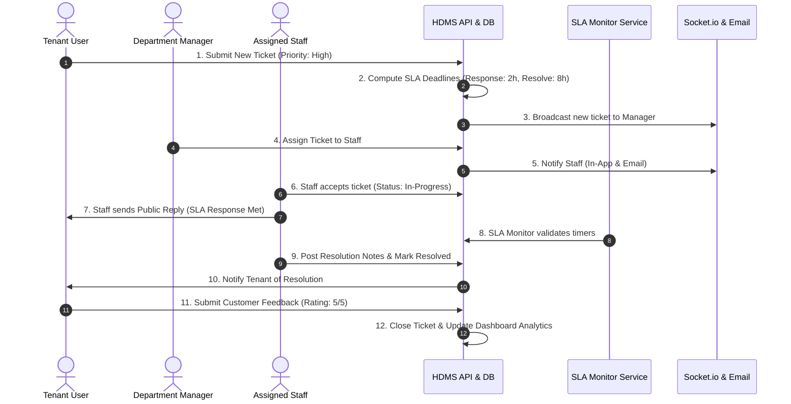
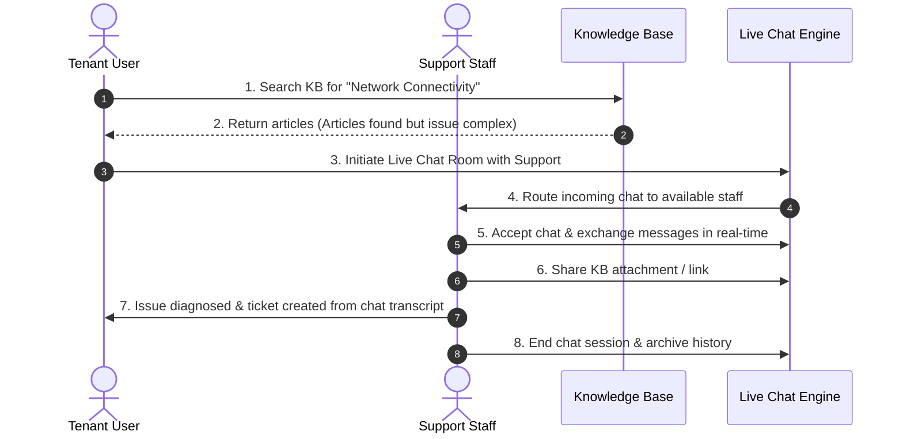

# PHASE 1: STANDALONE HDMS MASTER TEST SPECIFICATION & VERIFICATION DOCUMENT
**Help Desk Management System (HDMS)**  
*Document Version:* `1.0.0`  
*Scope:* Phase 1 — Standalone HDMS System Testing  
*Target Environment:* Node.js (Express backend) + MySQL + React/TypeScript Frontend  

---

## TABLE OF CONTENTS
1. [Test Strategy & Execution Guidelines](#1-test-strategy--execution-guidelines)
2. [Module 1: Authentication Testing](#module-1-authentication-testing)
3. [Module 2: JWT (JSON Web Token) Testing](#module-2-jwt-json-web-token-testing)
4. [Module 3: RBAC (Role-Based Access Control)](#module-3-rbac-role-based-access-control)
5. [Module 4: User Management Testing](#module-4-user-management-testing)
6. [Module 5: Roles Testing](#module-5-roles-testing)
7. [Module 6: Permissions Testing](#module-6-permissions-testing)
8. [Module 7: Departments & Assignment Testing](#module-7-departments--assignment-testing)
9. [Module 8: Tickets Lifecycle & Workflow Testing](#module-8-tickets-lifecycle--workflow-testing)
10. [Module 9: SLA (Service Level Agreement) Management](#module-9-sla-service-level-agreement-management)
11. [Module 10: In-App & Socket Notifications](#module-10-in-app--socket-notifications)
12. [Module 11: Email Notification Service](#module-11-email-notification-service)
13. [Module 12: Knowledge Base (KB) Management](#module-12-knowledge-base-kb-management)
14. [Module 13: Real-Time Chat & Collaboration](#module-13-real-time-chat--collaboration)
15. [Module 14: File Uploads & Attachment Security](#module-14-file-uploads--attachment-security)
16. [Module 15: Role-Based Dashboards & Analytics](#module-15-role-based-dashboards--analytics)
17. [Module 16: Database Integrity & Migration Testing](#module-16-database-integrity--migration-testing)
18. [Module 17: REST API & Validation Architecture](#module-17-rest-api--validation-architecture)
19. [Module 18: Application Security & OWASP Top 10](#module-18-application-security--owasp-top-10)
20. [Module 19: End-to-End (E2E) Business Workflows](#module-19-end-to-end-e2e-business-workflows)
21. [Test Execution Sign-Off Matrix](#20-test-execution-sign-off-matrix)

---

## 1. Test Strategy & Execution Guidelines

### 1.1 Test Levels & Methodology
* **Unit & Integration:** API endpoint responses, middleware validation, database transactions, service layer business logic.
* **Functional / System Testing:** UI interactions, role authorization guards, state synchronization via Socket.io.
* **Security & Negative Testing:** Token tampering, SQL injection, privilege escalation, file upload bypass.
* **End-to-End Verification:** Multi-persona journeys spanning Tenant, Staff, Manager, Admin, and CEO.

### 1.2 Test Case Notation
* **ID Format:** `TC-[MODULE]-[001]`
* **Priority:** `P1` (Critical/Blocker), `P2` (High), `P3` (Medium), `P4` (Low)
* **Status:** `Pass` | `Fail` | `Blocked` | `Pending`

---

## Module 1: Authentication Testing

| Test Case ID | Test Scenario | Preconditions / Input | Expected Result | Priority |
| :--- | :--- | :--- | :--- | :--- |
| `TC-AUTH-001` | Successful Login with Username | Valid active username and matching password | 200 OK returned; JWT access token and refresh token issued; user info returned. | `P1` |
| `TC-AUTH-002` | Successful Login with Email | Valid active email and matching password | 200 OK returned; authenticated session established. | `P1` |
| `TC-AUTH-003` | Invalid Password Rejection | Valid username, invalid password | 401 Unauthorized (`Invalid credentials`); no token issued; audit log recorded. | `P1` |
| `TC-AUTH-004` | Non-existent User Rejection | Non-registered email/username | 401 Unauthorized (`Invalid credentials`); prevent user enumeration. | `P1` |
| `TC-AUTH-005` | Inactive / Suspended Account Block | Account with `status = 'inactive'` or `status = 'suspended'` | 401/403 Forbidden (`Account is inactive or suspended`); login rejected. | `P1` |
| `TC-AUTH-006` | Password Hashing Verification | Inspect database record for newly registered/updated user | Plaintext password must never be stored; verify Bcrypt salt rounds (>= 10). | `P1` |
| `TC-AUTH-007` | User Logout & Token Invalidation | User invokes `/api/auth/logout` | Refresh token invalidated in DB; HTTP cookies cleared; subsequent calls blocked. | `P2` |
| `TC-AUTH-008` | Login History & Audit Trail | Login attempts (success and failure) | `login_history` and `audit_logs` record IP address, user agent, timestamp, and status. | `P2` |

---

## Module 2: JWT (JSON Web Token) Testing

| Test Case ID | Test Scenario | Preconditions / Input | Expected Result | Priority |
| :--- | :--- | :--- | :--- | :--- |
| `TC-JWT-001` | Access Token Format & Payload | Valid login | JWT token contains valid header (`HS256`), payload (`sub`, `tenant_id`, `role_id`, `exp`). | `P1` |
| `TC-JWT-002` | Protected Endpoint Access via Bearer Token | `Authorization: Bearer <valid_access_token>` | 200 OK; access granted to authenticated route. | `P1` |
| `TC-JWT-003` | Access Token Expiration Handling | Expired access token passed in header | 401 Unauthorized (`Token expired`); client prompted to refresh token. | `P1` |
| `TC-JWT-004` | Token Refresh Rotation | Valid refresh token sent to `/api/auth/refresh` | New access token issued; old refresh token rotated or updated in `refresh_tokens`. | `P1` |
| `TC-JWT-005` | Revoked / Replaced Refresh Token Reuse | Reusing previously invalidated refresh token | 401/403 Forbidden; system flags potential token theft and revokes family. | `P2` |
| `TC-JWT-006` | Tampered Signature Rejection | Token payload or signature altered | 401 Unauthorized (`Invalid token signature`); request immediately rejected. | `P1` |
| `TC-JWT-007` | Missing Authorization Header | Request made without `Authorization` or cookie | 401 Unauthorized (`Authentication required`). | `P1` |

---

## Module 3: RBAC (Role-Based Access Control)

| Test Case ID | Test Scenario | Preconditions / Input | Expected Result | Priority |
| :--- | :--- | :--- | :--- | :--- |
| `TC-RBAC-001` | Admin Full System Access | User logged in as `admin` | Full CRUD access to users, roles, departments, system configs, notices. | `P1` |
| `TC-RBAC-002` | CEO High-Level Dashboard & Oversight Access | User logged in as `ceo` | Read-only/High-level analytics, organization KPIs, executive summaries. | `P2` |
| `TC-RBAC-003` | Manager Departmental Access Guard | User logged in as `manager` | Can assign/manage department tickets and team staff; cannot modify global tenants/roles. | `P1` |
| `TC-RBAC-004` | Staff Operational Access Guard | User logged in as `staff` | Can view and update tickets assigned to self/department; cannot delete system entities. | `P1` |
| `TC-RBAC-005` | Tenant Self-Service Isolation | User logged in as `tenant` | Can create tickets and view ONLY own organization/department tickets; cannot see other tenants. | `P1` |
| `TC-RBAC-006` | Cross-Tenant Data Isolation (Multi-Tenancy) | Tenant A requesting Tenant B ticket `GET /api/tickets/:id` | 403 Forbidden or 404 Not Found; strict `tenant_id` query scoping enforced. | `P1` |
| `TC-RBAC-007` | Unauthorized Privilege Escalation Attempt | Staff making `POST /api/users` or `DELETE /api/departments/:id` | 403 Forbidden (`Role not allowed` / `Insufficient permissions`). | `P1` |

---

## Module 4: User Management Testing

| Test Case ID | Test Scenario | Preconditions / Input | Expected Result | Priority |
| :--- | :--- | :--- | :--- | :--- |
| `TC-USER-001` | Create New User (Admin) | Valid user payload (name, email, role, department, tenant) | 201 Created; auto-generated `user_code`; password securely hashed; DB row added. | `P1` |
| `TC-USER-002` | Duplicate Email / Username Prevention | Register with existing email or username | 409 Conflict or 422 Unprocessable Entity with distinct error message. | `P1` |
| `TC-USER-003` | User List with Pagination & Filters | `GET /api/users?page=1&limit=10&role=staff` | Correct paginated records returned with total count and metadata. | `P2` |
| `TC-USER-004` | Update User Profile & Details | Edit name, phone, department, theme preference | Changes persisted; `updated_at` timestamp updated; audit log generated. | `P2` |
| `TC-USER-005` | Status Toggle (Active / Inactive / Suspended) | Change user status to `inactive` | User immediately unable to authenticate or execute active sessions. | `P1` |
| `TC-USER-006` | User Password Reset / Change | User initiates password update with old + new password | Old password validated; new password hashed; all active sessions refreshed. | `P2` |

---

## Module 5: Roles Testing

| Test Case ID | Test Scenario | Preconditions / Input | Expected Result | Priority |
| :--- | :--- | :--- | :--- | :--- |
| `TC-ROLE-001` | Verify Predefined System Roles | Query `roles` table (`admin`, `manager`, `staff`, `tenant`, `ceo`) | All 5 standard roles exist with correct IDs and unique constraints. | `P1` |
| `TC-ROLE-002` | Role Assignment on User Creation | Assign role during user provisioning | Correct `role_id` stored in `users` table; correct role privileges reflected on login. | `P1` |
| `TC-ROLE-003` | Role Modification / Reassignment | Admin updates user role from `staff` to `manager` | Token refresh updates user permissions; new dashboard layout dynamically loaded. | `P2` |
| `TC-ROLE-004` | Role Deletion Prevention | Attempt to delete system critical role | Blocked by database foreign key constraint or application protection. | `P2` |

---

## Module 6: Permissions Testing

| Test Case ID | Test Scenario | Preconditions / Input | Expected Result | Priority |
| :--- | :--- | :--- | :--- | :--- |
| `TC-PERM-001` | Permission Table Seeding | Inspect `permissions` table | All granular permissions (e.g., `ticket:create`, `ticket:assign`, `user:manage`) seeded. | `P1` |
| `TC-PERM-002` | Role-Permission Mapping Matrix | Inspect `role_permissions` table | Roles correctly linked to authorized permission IDs without orphaned records. | `P1` |
| `TC-PERM-003` | Dynamic Permission Evaluation Middleware | Middleware `authorize('ticket:delete')` | User possessing permission code passes `next()`; unpermitted user receives 403 Forbidden. | `P1` |
| `TC-PERM-004` | Frontend UI Dynamic Action Guard | Component evaluates user permissions | Action buttons (Edit, Delete, Assign) hidden or disabled for unpermitted users. | `P2` |

---

## Module 7: Departments & Assignment Testing

| Test Case ID | Test Scenario | Preconditions / Input | Expected Result | Priority |
| :--- | :--- | :--- | :--- | :--- |
| `TC-DEPT-001` | Create Department | Name, code, description, manager ID | 201 Created; department created and linked with manager. | `P2` |
| `TC-DEPT-002` | User Multi-Department Association | Link user via `user_departments` table | User successfully mapped to primary and secondary departments. | `P2` |
| `TC-DEPT-003` | Department Ticket Queue Routing | Ticket submitted for "IT Support" | Ticket appears in "IT Support" department queue for department staff/manager. | `P1` |
| `TC-DEPT-004` | Department Deletion Safeguards | Delete department with active tickets | 400 Bad Request / Constraint error; deletion prevented until tickets re-routed. | `P2` |

---

## Module 8: Tickets Lifecycle & Workflow Testing

| Test Case ID | Test Scenario | Preconditions / Input | Expected Result | Priority |
| :--- | :--- | :--- | :--- | :--- |
| `TC-TCK-001` | Ticket Creation with Category & Priority | Title, description, category_id, priority (`low`, `medium`, `high`, `urgent`) | 201 Created; ticket code generated (`TCK-YYYYMMDD-XXXX`); initial status `open` or `pending`. | `P1` |
| `TC-TCK-002` | Automatic SLA Policy Attachment | Ticket created with given priority | `sla_policy_id`, `sla_response_deadline`, and `sla_resolution_deadline` computed. | `P1` |
| `TC-TCK-003` | Ticket Assignment to Staff / Team | Manager assigns ticket to specific staff member | `assignments` record inserted; assigned staff notified via in-app & email; status -> `assigned`. | `P1` |
| `TC-TCK-004` | Ticket Status Transition Workflow | `open` -> `assigned` -> `in_progress` -> `resolved` -> `closed` | Status updates logged in `ticket_status_history` with actor ID and timestamp. | `P1` |
| `TC-TCK-005` | Invalid Status Jump Guard | Attempting to close an unopened ticket without resolution | Application rejects invalid lifecycle transition with descriptive error. | `P2` |
| `TC-TCK-006` | Public & Internal Ticket Replies | Reply posted with `is_internal = true` vs `false` | Internal replies visible only to staff/manager/admin; public replies visible to tenant. | `P1` |
| `TC-TCK-007` | Ticket Resolution & Customer Feedback | Ticket marked `resolved`; tenant rates satisfaction | Feedback record saved in `feedback` table (rating 1-5, comments); SLA stopped. | `P2` |
| `TC-TCK-008` | Reopening Resolved Tickets | Tenant replies on `resolved` ticket within allowed window | Ticket status resets to `reopened` / `in_progress`; assigned staff notified. | `P2` |

---

## Module 9: SLA (Service Level Agreement) Management

| Test Case ID | Test Scenario | Preconditions / Input | Expected Result | Priority |
| :--- | :--- | :--- | :--- | :--- |
| `TC-SLA-001` | SLA Policy Configuration | Define response (e.g. 1 hr) and resolution (e.g. 8 hrs) per priority | Policy saved in `sla_policies` table; applies to matching priority tickets. | `P1` |
| `TC-SLA-002` | First Response Time Metric Calculation | Staff posts first public reply | `first_response_at` recorded; response SLA met/breached flag calculated. | `P1` |
| `TC-SLA-003` | SLA Warning Trigger (Approaching Breach) | Ticket passes 75% or 80% of allowed SLA time | Warning notification sent to assigned agent and department manager. | `P2` |
| `TC-SLA-004` | SLA Breach State & Escalation | Ticket unresolved past deadline | Ticket flagged as `is_sla_breached = 1`; escalation notification dispatched. | `P1` |
| `TC-SLA-005` | SLA Background Monitor Job | Node cron/interval job `slaMonitorService.js` | Periodically scans active tickets, recalculates remaining time, triggers alerts. | `P1` |
| `TC-SLA-006` | SLA Pause on Waiting Status | Ticket placed in `waiting_on_customer` status | SLA resolution timer pauses (or remaining time adjusts) until customer responds. | `P3` |

---

## Module 10: In-App & Socket Notifications

| Test Case ID | Test Scenario | Preconditions / Input | Expected Result | Priority |
| :--- | :--- | :--- | :--- | :--- |
| `TC-NOTIF-001` | Real-Time Socket Notification Dispatch | Ticket assigned, reply added, or mention | Socket event (`notification:new`) emitted to target user room in real-time. | `P1` |
| `TC-NOTIF-002` | Persistent Notification DB Storage | Notification event occurs | Row inserted into `notifications` table (`user_id`, `title`, `message`, `type`, `is_read=0`). | `P1` |
| `TC-NOTIF-003` | Unread Notification Count Badge | User loads application / receives event | Bell icon displays correct live badge count of unread items. | `P2` |
| `TC-NOTIF-004` | Mark Single Notification as Read | User clicks notification item | `is_read` updated to `1`; unread badge count decrements immediately. | `P2` |
| `TC-NOTIF-005` | Mark All Notifications as Read | User clicks "Mark All as Read" | Batch update sets all user notifications to read; badge resets to 0. | `P2` |
| `TC-NOTIF-006` | Notification Filtering by Type | Filter by `ticket`, `system`, `chat`, `sla` | Correct filtered notifications list displayed. | `P3` |

---

## Module 11: Email Notification Service

| Test Case ID | Test Scenario | Preconditions / Input | Expected Result | Priority |
| :--- | :--- | :--- | :--- | :--- |
| `TC-MAIL-001` | SMTP Configuration & Connection Health | App startup with valid SMTP credentials | Nodemailer transport verifies successfully without connection timeout. | `P1` |
| `TC-MAIL-002` | Ticket Created Confirmation Email | Tenant creates ticket | HTML formatted email delivered to tenant with ticket reference and link. | `P1` |
| `TC-MAIL-003` | Ticket Assignment Staff Alert Email | Ticket assigned to staff | Email delivered to staff with ticket summary, priority, and SLA target. | `P1` |
| `TC-MAIL-004` | SLA Breach Warning Alert Email | SLA monitor detects breach | Immediate alert email sent to department manager and assigned staff. | `P1` |
| `TC-MAIL-005` | Email Error & Fallback Resilience | SMTP service temporarily unreachable | Error handled gracefully; logged without crashing the Express server thread. | `P2` |

---

## Module 12: Knowledge Base (KB) Management

| Test Case ID | Test Scenario | Preconditions / Input | Expected Result | Priority |
| :--- | :--- | :--- | :--- | :--- |
| `TC-KB-001` | Create Knowledge Article (Staff/Admin) | Title, content, category_id, tags, status (`draft`, `published`) | 201 Created; slug generated; article saved in `knowledge_base`. | `P2` |
| `TC-KB-002` | Article Category Hierarchy | Categories with parent-child relationships | Category tree rendered accurately; articles grouped correctly. | `P2` |
| `TC-KB-003` | Full-Text Search & Tag Filtering | Search query string (e.g. "VPN setup") | Relevant published articles returned with keyword matching. | `P1` |
| `TC-KB-004` | Article Versioning & Revision History | Edit published article | New revision logged in `knowledge_article_versions`; rollback possible. | `P2` |
| `TC-KB-005` | Access Control (Public vs Restricted) | Article marked internal only | Visible only to internal staff; hidden from external tenant users. | `P1` |
| `TC-KB-006` | Helpful / Unhelpful Feedback Counter | User clicks "Was this helpful? Yes/No" | Counter increments; feedback stored for KB effectiveness analytics. | `P3` |

---

## Module 13: Real-Time Chat & Collaboration

| Test Case ID | Test Scenario | Preconditions / Input | Expected Result | Priority |
| :--- | :--- | :--- | :--- | :--- |
| `TC-CHAT-001` | Direct 1-on-1 Chat Room Creation | User initiates chat with another user | Chat room established in `chat_rooms` with 2 entries in `chat_participants`. | `P1` |
| `TC-CHAT-002` | Group & Department Chat Rooms | Multiple participants joined | Messages broadcasted to all room participants via Socket.io. | `P1` |
| `TC-CHAT-003` | Real-Time Message Transmission | User A sends message | Message immediately renders on User B's active chat window without page refresh. | `P1` |
| `TC-CHAT-004` | Typing Indicator Signaling | User starts/stops typing | `typing_indicators` event emits `user_typing` status to other room members. | `P2` |
| `TC-CHAT-005` | Read Receipt Tracking | Receiver views message | `message_read_status` updated; double checkmarks or "Seen" indicator shown. | `P2` |
| `TC-CHAT-006` | Online / Offline Presence Tracking | User connects or disconnects socket | `user_online_status` table and presence badges update live across clients. | `P2` |
| `TC-CHAT-007` | Chat File & Media Attachments | Send image/document in chat | File stored via Multer; attachment linked in `chat_attachments`; preview rendered. | `P2` |

---

## Module 14: File Uploads & Attachment Security

| Test Case ID | Test Scenario | Preconditions / Input | Expected Result | Priority |
| :--- | :--- | :--- | :--- | :--- |
| `TC-FILE-001` | Valid File Upload (PDF, PNG, JPG, DOCX) | Upload legitimate file (< 10MB) | File saved in `/uploads` with sanitized UUID name; metadata saved in DB. | `P1` |
| `TC-FILE-002` | Disallowed File Extension Rejection | Attempt to upload `.exe`, `.bat`, `.sh`, `.php`, `.js` | 400 Bad Request (`Invalid file type`); upload immediately blocked. | `P1` |
| `TC-FILE-003` | File Size Exceeded Limit Rejection | Attempt to upload file > configured limit (e.g. > 10MB) | 400 Bad Request (`File size exceeds limit`); upload rejected. | `P1` |
| `TC-FILE-004` | Path Traversal File Name Sanitization | Filename containing `../../etc/passwd` | Filename sanitized or renamed with UUID; saved safely in uploads folder. | `P1` |
| `TC-FILE-005` | Secure File Download & Access Guard | Request `GET /uploads/:filename` or download route | User must be authenticated and authorized to access the related ticket/entity. | `P1` |

---

## Module 15: Role-Based Dashboards & Analytics

| Test Case ID | Test Scenario | Preconditions / Input | Expected Result | Priority |
| :--- | :--- | :--- | :--- | :--- |
| `TC-DASH-001` | Admin Global Metrics Dashboard | Log in as Admin | Shows total tickets, open tickets, SLA breach rate, active users, system logs. | `P1` |
| `TC-DASH-002` | CEO Strategic KPI Dashboard | Log in as CEO | Shows high-level KPIs, resolution efficiency, department comparisons, trends. | `P2` |
| `TC-DASH-003` | Manager Departmental Dashboard | Log in as Manager | Shows department ticket queues, team workload distribution, pending assignments. | `P1` |
| `TC-DASH-004` | Staff Operational Dashboard | Log in as Staff | Shows "My Assigned Tickets", SLA countdown timers, recent replies, urgent tasks. | `P1` |
| `TC-DASH-005` | Tenant Customer Portal Dashboard | Log in as Tenant | Shows "My Open Tickets", "Ticket Status History", and "Knowledge Base" shortcuts. | `P1` |
| `TC-DASH-006` | Real-Time Metric Refresh | Ticket created or status changed | Dashboard counter cards update dynamically or on refresh. | `P2` |

---

## Module 16: Database Integrity & Migration Testing

| Test Case ID | Test Scenario | Preconditions / Input | Expected Result | Priority |
| :--- | :--- | :--- | :--- | :--- |
| `TC-DB-001` | Schema Clean Deployment | Run `backend/sql/database.sql` on empty DB | All tables, triggers, seeds, and foreign keys created without errors. | `P1` |
| `TC-DB-002` | Foreign Key Referential Integrity | Attempt to insert ticket with non-existent `user_id` | Database rejects insert with Foreign Key Constraint violation. | `P1` |
| `TC-DB-003` | Transaction Rollback on Multi-Table Error | Ticket creation failure midway | Database transaction rolls back; no orphaned rows in `tickets` or `assignments`. | `P1` |
| `TC-DB-004` | Unique Index Constraints | Attempt duplicate in unique columns (email, username, code) | DB rejects with Duplicate Entry error. | `P1` |
| `TC-DB-005` | Character Encoding & UTF-8 Support | Insert multilingual text and emojis in tickets/replies | Stored and retrieved accurately without corruption (`utf8mb4`). | `P2` |

---

## Module 17: REST API & Validation Architecture

| Test Case ID | Test Scenario | Preconditions / Input | Expected Result | Priority |
| :--- | :--- | :--- | :--- | :--- |
| `TC-API-001` | Uniform JSON Response Structure | Any standard API request | Response conforms to `{ success: boolean, data?: any, message?: string, errors?: any }`. | `P1` |
| `TC-API-002` | Express-Validator Input Validation | Invalid email format or empty required fields | 422 Unprocessable Entity with field-specific validation error details. | `P1` |
| `TC-API-003` | Standard HTTP Status Codes | Various request outcomes | Correct codes used: `200` OK, `201` Created, `400` Bad Req, `401` Unauth, `403` Forbid, `404` Not Found, `500` Server Err. | `P1` |
| `TC-API-004` | API Rate Limiting | Spamming requests past configured threshold (e.g. > 100/15min) | 429 Too Many Requests (`Rate limit exceeded`); server protected from DoS. | `P2` |
| `TC-API-005` | Global Error Handling Middleware | Uncaught exception in async controller route | 500 Internal Server Error returned cleanly without leaking raw server stack traces. | `P1` |

---

## Module 18: Application Security & OWASP Top 10

| Test Case ID | Test Scenario | Preconditions / Input | Expected Result | Priority |
| :--- | :--- | :--- | :--- | :--- |
| `TC-SEC-001` | SQL Injection (SQLi) Prevention | Inject `' OR 1=1 --` into login or search fields | Input treated as literal string via parameterized queries (`mysql2`); no data leak. | `P1` |
| `TC-SEC-002` | Stored & Reflected XSS Prevention | Inject `<script>alert('XSS')</script>` in ticket description | Input sanitized / HTML escaped; script does not execute in client browser. | `P1` |
| `TC-SEC-003` | Security Headers (Helmet Middleware) | Inspect response headers | `X-Content-Type-Options: nosniff`, `X-Frame-Options: DENY`, `Strict-Transport-Security` present. | `P2` |
| `TC-SEC-004` | CORS Policy Enforcement | Request API from unlisted unauthorized origin | CORS error blocked by browser; unauthorized origin disallowed. | `P1` |
| `TC-SEC-005` | Insecure Direct Object Reference (IDOR) | Tenant user requests `/api/tickets/:id` of another tenant | 403 Forbidden; system validates ownership before returning resource. | `P1` |
| `TC-SEC-006` | Sensitive Data Masking | Inspect API responses for user records | `password_hash`, salt, or private keys never exposed in JSON responses. | `P1` |

---

## Module 19: End-to-End (E2E) Business Workflows

### E2E Flow 1: Full Ticket Lifecycle with SLA & Department Assignment


### E2E Flow 2: Live Support Chat & Knowledge Base Escalation


---

## 20. Test Execution Sign-Off Matrix

Use this tracking sheet to record test runs during Phase 1 Standalone HDMS verification.

| Category / Area | Total TCs | Passed | Failed | Blocked | Pass Rate (%) | Tester Sign-off | Date |
| :--- | :---: | :---: | :---: | :---: | :---: | :---: | :---: |
| 1. Authentication | 8 | | | | | | |
| 2. JWT | 7 | | | | | | |
| 3. RBAC | 7 | | | | | | |
| 4. Users | 6 | | | | | | |
| 5. Roles | 4 | | | | | | |
| 6. Permissions | 4 | | | | | | |
| 7. Departments | 4 | | | | | | |
| 8. Tickets | 8 | | | | | | |
| 9. SLA Management | 6 | | | | | | |
| 10. Notifications | 6 | | | | | | |
| 11. Email Service | 5 | | | | | | |
| 12. Knowledge Base | 6 | | | | | | |
| 13. Chat System | 7 | | | | | | |
| 14. Attachments | 5 | | | | | | |
| 15. Dashboards | 6 | | | | | | |
| 16. Database | 5 | | | | | | |
| 17. REST API | 5 | | | | | | |
| 18. Security & OWASP | 6 | | | | | | |
| 19. End-to-End Workflows | 2 | | | | | | |
| **TOTALS** | **107** | | | | | | |

---

## Automated Verification Quick Commands

To run backend tests or sanity checks:
```powershell
# Verify backend connection and schema
cd c:\Users\ITPC\Desktop\DMS\DMS\backend
node check_db.js

# Test hashing & auth primitives
node test_hash.js
node test_repo.js

# Start backend in watch mode
npm run dev
```

*Generated for HDMS Phase 1 Standalone Verification.*
